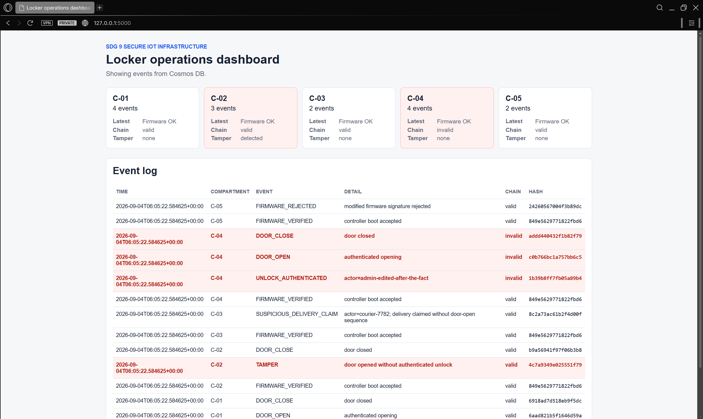
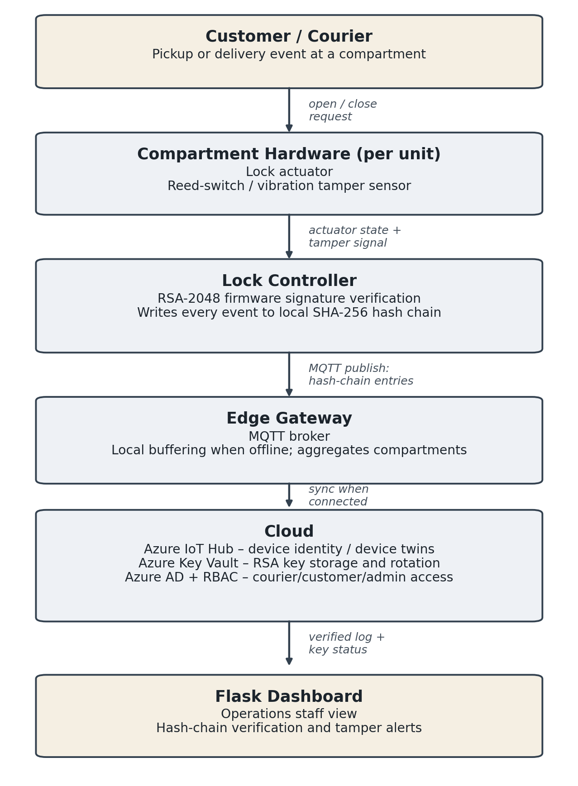

# Secure Smart Parcel Locker (IoT)

A security-focused prototype of a smart parcel locker for last-mile delivery. It detects physical tampering, makes event logs tamper-evident, rejects modified firmware, and streams evidence to Azure for an operator dashboard.

Built for the Internet of Things module of my BSc (Hons) Cyber Security at Coventry University (PSB Academy, Singapore), 2026.



## The problem

Parcel lockers can fail in ways a normal application log never shows: a door forced open without an electronic unlock, a courier falsely claiming a delivery, or modified firmware hiding events. This prototype treats the **physical sequence** (unlock → door open → door close) and the **digital claim** as separate evidence and checks that they agree.

## Security controls

| Control | How it works | What it catches |
|---|---|---|
| Tamper-aware door rules | A door-open signal without a prior authenticated unlock creates a `TAMPER` event | Forced or bypassed doors |
| Delivery-claim check | A delivery claim with no supporting door-open sequence creates `SUSPICIOUS_DELIVERY_CLAIM` | Courier fraud |
| SHA-256 hash chain | Each event is hashed with the previous event's hash, per compartment | Edits to historical records |
| RSA-2048 firmware signing | Controller images are verified against a trusted public key before boot | Modified or malicious firmware |
| Cloud evidence | Events go to a local log first, then Azure IoT Hub and Cosmos DB | Loss of evidence on the device |

## Architecture



The prototype implements the controller logic, local log, Azure IoT Hub, Cosmos DB and dashboard in software across five simulated compartments (C-01 to C-05). Physical sensors, an edge gateway and Azure Key Vault are proposed extensions.

## Test results

| Scenario | Expected | Result |
|---|---|---|
| Authenticated access (C-01) | Unlock, open, close sequence | Pass |
| Unauthorised door opening (C-02) | `TAMPER` event | Pass |
| False delivery claim (C-03) | `SUSPICIOUS_DELIVERY_CLAIM` | Pass |
| Historical record edit (C-04) | Broken hash chain | Pass — 3 entries flagged invalid |
| Modified firmware (C-05) | Signature rejected | Pass |
| Azure integration | IoT Hub publish and Cosmos DB store | Pass |

## Run the simulation

```bash
python -m venv .venv
# Windows: .\.venv\Scripts\Activate.ps1   macOS/Linux: source .venv/bin/activate
pip install -r requirements.txt
python simulate_scenarios.py
```

It runs offline: without Azure credentials it skips IoT Hub and Cosmos DB and writes events locally. To enable the cloud path, copy `.env.example` to `.env` and fill in your own IoT Hub connection string and Cosmos DB endpoint/key. Never commit `.env`.

To open the operator dashboard after running the simulation:

```bash
python app.py
```

Then go to http://127.0.0.1:5000.

## Tech stack

Python · Flask · Azure IoT Hub · Azure Cosmos DB · `cryptography` (RSA-2048, SHA-256)

## Files

| File | Purpose |
|---|---|
| `locker_controller.py` | Door, unlock, tamper and delivery-claim rules |
| `hash_chain.py` | SHA-256 hash-chain log and verification |
| `firmware_security.py` | RSA key generation, signing and verification |
| `cloud_logging.py` | Local log, IoT Hub publish, Cosmos DB read/write |
| `simulate_scenarios.py` | Runs the five test scenarios |
| `app.py` | Flask operator dashboard (`templates/`, `static/`) |
